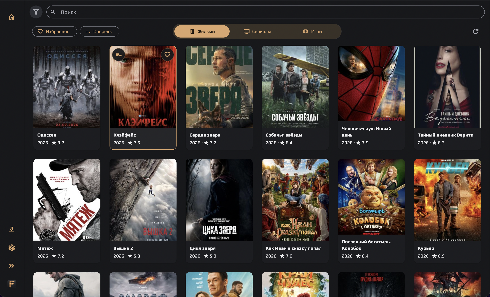
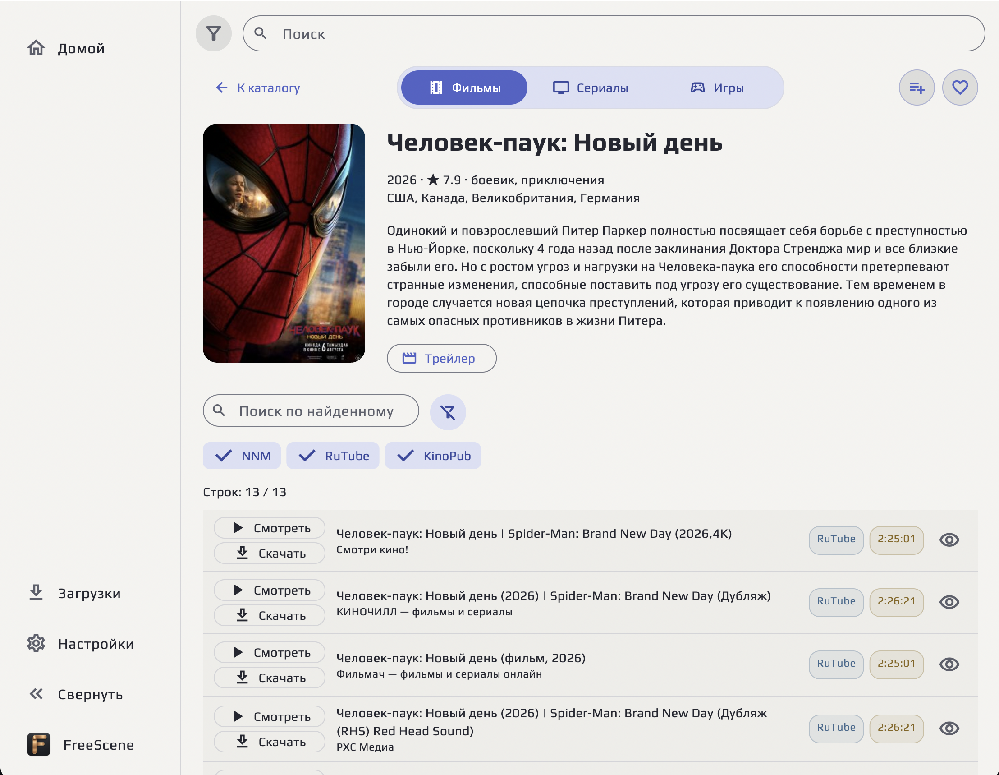

# FreeScene

**Фильмы, сериалы и игры в одном приложении для macOS, Android и Android TV.**

FreeScene объединяет каталог, поиск по нескольким источникам, встроенный
видеоплеер и загрузки. Добавляйте фильмы в избранное и очередь, отмечайте
просмотренное и выбирайте подходящий вариант по качеству, озвучке и размеру.
Интерфейс адаптирован для мыши, сенсорного экрана и телевизионного пульта.

**[Скачать последнюю версию](https://github.com/RarogVA/freescene/releases/latest)**
· [Сообщить о проблеме](https://github.com/RarogVA/freescene/issues)

## Возможности

- Каталог фильмов и сериалов с описаниями, рейтингами, поиском и фильтрами.
  В сортировке «Новые» остаются карточки с видео либо официальным тизером/трейлером.
- Несколько источников в одной карточке: Zona, NNM, RuTube, KinoPub, RHS
  и VK Видео. Провайдеры включаются отдельно в настройках.
- Гостевой поиск VK Видео без аккаунта и воспроизведение в плеере FreeScene.
  Отдельный рекламный плеер VK не загружается; реклама внутри самого ролика
  может оставаться.
- Встроенные плееры с перемоткой, дорожками, субтитрами и масштабированием
  видео — по возможностям конкретного источника. На Android и TV сохраняется
  позиция просмотра; при повторном запуске можно продолжить или начать сначала.
- Управление Android TV с пульта: на шкале времени одно нажатие перематывает
  на 10 секунд, удержание увеличивает шаг от одной до пяти минут.
- Избранное, очередь и отметки «Просмотрено»; автоматическая отметка после
  минуты фактического воспроизведения, без учёта перемотки и пауз.
- Загрузки и просмотр торрент-видео во время загрузки, открытие локальных
  видеофайлов. Для macOS также доступен каталог игр с AppsTorrent.
- Светлая и тёмная темы, выбор акцента, русский и английский интерфейс.
- Проверка и установка обновлений из приложения без GitHub-токена.

## Скриншоты

Каталог в тёмной теме со свёрнутой боковой панелью:



Карточка фильма и список вариантов просмотра в светлой теме:



## Установка

Все сборки находятся на [странице последнего релиза](https://github.com/RarogVA/freescene/releases/latest).

| Устройство | Файл |
| --- | --- |
| Mac с Apple Silicon (M1 и новее) | `FreeScene-…-macos-arm64.dmg` |
| Mac с процессором Intel | `FreeScene-…-macos-x86_64.dmg` |
| Android: телефон или планшет | `app-arm64-v8a-mobile-release.apk` |
| Android TV / Google TV | `app-arm64-v8a-tv-release.apk` |
| Android с 32-битной ARM-системой | соответствующий APK `armeabi-v7a` |

**macOS:** откройте DMG и перенесите FreeScene в «Программы». Если macOS
блокирует запуск, в образе есть скрипт «Исправить запуск»: он выполняет
`xattr -r -c /Applications/FreeScene.app` для установленного приложения.

**Android:** установите APK для своего устройства. Мобильная и TV-версии
имеют разные интерфейсы управления. Обновляйте приложение APK того же типа.

В приложении откройте «О приложении» → «Проверить обновления». При наличии
нового выпуска кнопка предложит установку. Там же доступны лицензии открытого ПО.

## Исходный код и сборка

Этот репозиторий содержит открытый интерфейс, движок, плееры и контракт
провайдеров. Он собирается самостоятельно с демонстрационным каталогом.
Официальная сборка включает приватные реализации провайдеров, которые
выполняются внутри приложения; отдельный сервер FreeScene не нужен.
Доступность видео зависит от источника и региона.

Нужны Flutter 3.47.7 / Dart 3.13.5:

```sh
flutter pub get
flutter analyze
flutter test
```

- Android: JDK 17 и Android SDK/NDK;
  `python3 tools/build_android.py --flavor mobile --preview`
  или `--flavor tv --preview`.
- macOS: Xcode, CMake, Boost и VLC 3.0.21;
  `python3 tools/build_freescene.py --destination build/preview --channel preview`.
  Для Intel добавьте `--arch x86_64 --vlc /path/to/intel/VLC.app`.

Документация: [контракт провайдеров](docs/provider-api.md),
[Android](docs/android.md), [подпись](docs/signing.md).

Исходный код распространяется по [MIT](LICENSE). У сторонних компонентов
собственные лицензии: [зависимости](docs/licensing.md),
[libVLC](docs/vlc-distribution.md), [Android audio](docs/android-audio.md).
Архивы исходников распространяемых VLC и Android audio-компонентов прилагаются
к официальным релизам.
